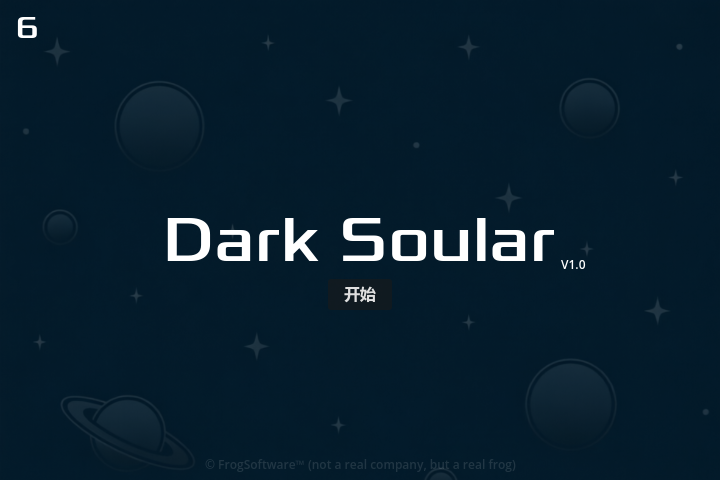
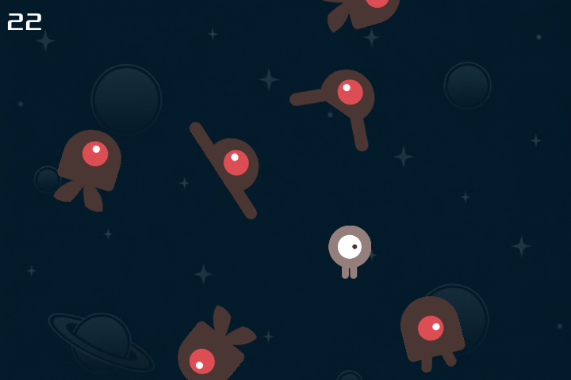

# Dark Soular
*Dark Soular* is a game demo created based on the official Godot tutorial "Dodge the Creeps!"

link: https://docs.godotengine.org/zh-cn/4.x/getting_started/first_2d_game/index.html#

## 关于导出可执行文件的体积优化方法
1. 项目 > 工具 > 引擎编译配置编辑器
2. 点击 从项目中检测
3. 另存为 documents\output_temp.gdbuild
4. 去 https://github.com/godotengine/godot 拉去项目使用的相同版本godot源码
5. 进入godot 源码根目录，打开终端，gcc、scons 等编译工具链依赖的安装不再赘述
6. 可能缺少Direct3D 12 SDK 依赖，运行：

    `python misc\scripts\install_d3d12_sdk_windows.py`
7. 开始编译（注意最后一个参数 build_profile 要填入刚才生成的 .gdbuild 文件正确路径）：

    `scons target=template_release build_profile=C:\Users\zhong\Desktop\godot-4.6.2-stable\output_temp.gdbuild`
8. 编译结束后得到 `godot源码根目录\bin\godot.windows.template_release.x86_64.exe
9. 在godot编辑器 导出 > 自定义模板 > 调试/发布 这两个输入框里，把第八条这个.exe的完整路径填上去
10. 继续导出，最终得到一份体积有明显缩小的可执行文件 `105MB -> 52MB`

